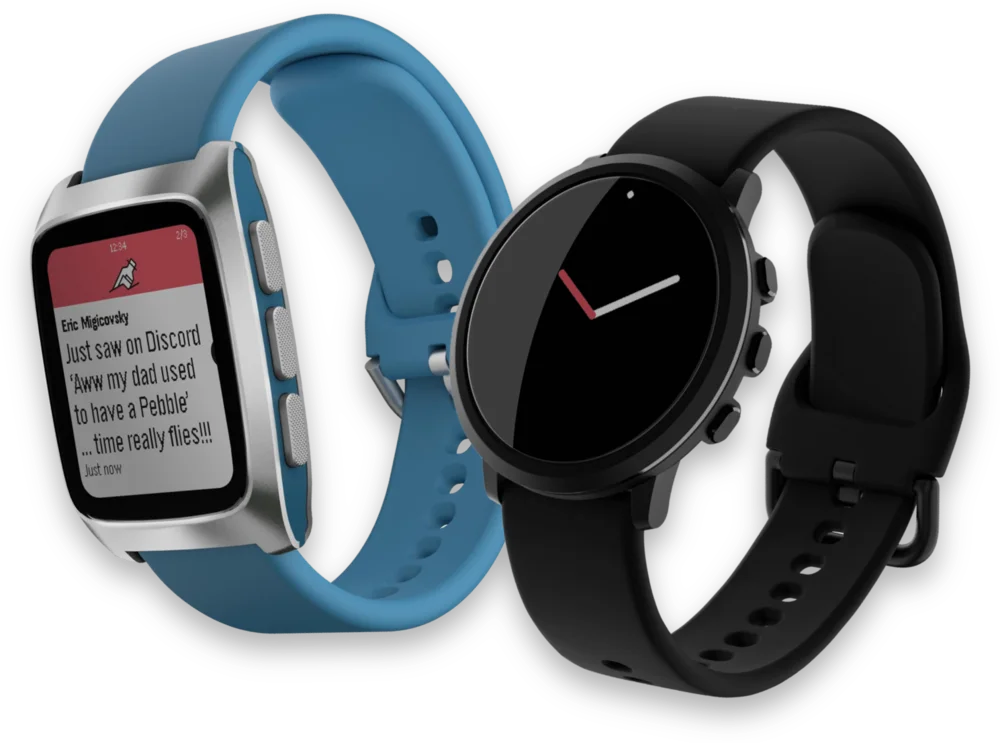

```{raw} html
<div style="display: none;">
```

# PebbleOS documentation

```{raw} html
</div>
```

:::::{div} home-hero




```{div} home-title
Welcome to the PebbleOS documentation site!
```

PebbleOS is a lightweight, power-efficient operating system originally developed for Pebble smartwatches and now [released open source](https://opensource.googleblog.com/2025/01/see-code-that-powered-pebble-smartwatches.html).
Optimized for memory-in-pixel (MIP) displays and long battery life, it features Bluetooth sync, a timeline interface, and a strong developer ecosystem through an open SDK.

````{div} home-actions

```{button-ref} getting_started/index
:ref-type: doc
:color: primary
:class: sd-rounded-pill

Get started
```

```{button-ref} playground
:ref-type: doc
:color: primary
:outline:
:class: sd-rounded-pill

Try it in the browser
```

````

:::::

::::{grid} 1 1 2 3
:gutter: 3

:::{grid-item-card} 🚀 Getting started
:link: getting_started/index
:link-type: doc

From a fresh machine to PebbleOS running in the emulator or on a watch.
:::

:::{grid-item-card} 🛠️ Development
:link: pbl/index
:link-type: doc

The `pbl` CLI and every command, the build system, tests, QEMU and debugging.
:::

:::{grid-item-card} 🏛️ Architecture
:link: architecture/index
:link-type: doc

How the firmware is layered: tasks, boot, processes and memory.
:::

:::{grid-item-card} ⚙️ Kernel
:link: kernel/index
:link-type: doc

Threads, synchronization, interrupts and scheduling.
:::

:::{grid-item-card} 🧩 Subsystems
:link: subsystems/index
:link-type: doc

Bluetooth, logging, input, the shell and the other OS subsystems.
:::

:::{grid-item-card} 🔌 Drivers
:link: drivers/index
:link-type: doc

The device model and every hardware driver class.
:::

:::{grid-item-card} 📡 Services
:link: services/index
:link-type: doc

System services between drivers and apps, from activity to timeline.
:::

:::{grid-item-card} ⌚ Boards
:link: boards/index
:link-type: doc

Supported watches and emulated boards, and how to program them.
:::

:::{grid-item-card} 📖 Reference
:link: reference/index
:link-type: doc

Protocols and file formats.
:::

::::

```{toctree}
:hidden:
:caption: Start here

getting_started/index.md
playground.md
```

```{toctree}
:hidden:
:caption: Development

pbl/index.md
development/build_system/index.md
development/emulation/index.md
development/tests/index.md
development/debugging/index.md
development/conventions.md
```

```{toctree}
:hidden:
:caption: System

architecture/index.md
kernel/index.md
subsystems/index.md
drivers/index.md
services/index.md
libraries/index.md
third_party/index.md
sdk/index.md
```

```{toctree}
:hidden:
:caption: Hardware

boards/index.md
programmers/index.md
```

```{toctree}
:hidden:
:caption: Community

community/contributing.md
```

```{toctree}
:hidden:
:caption: Reference

reference/index.md
reference/kconfig.md
API reference <apidoc://>
```
